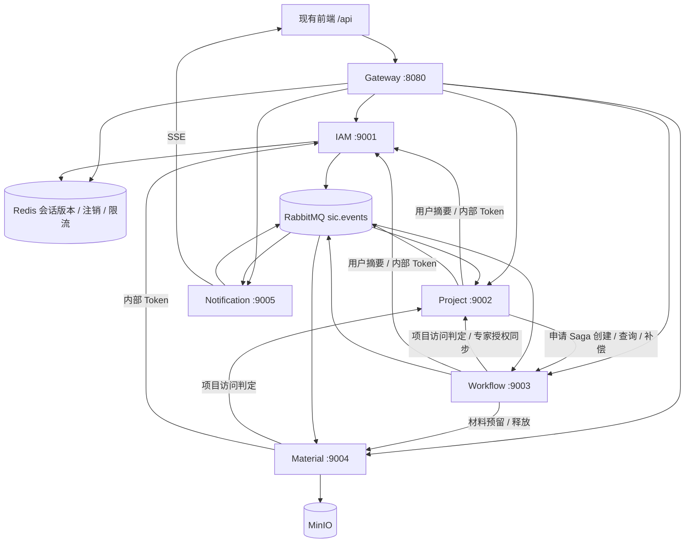
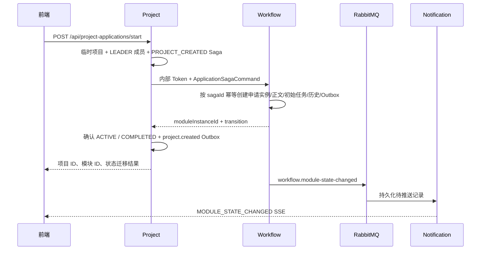

# SicProjectIS_cloud 项目结构与功能总览

后续调研：[服务内部的分层调整方案](service-layering-refactor-plan.md)、[Spring Cloud 技术栈核对](spring-cloud-stack-audit.md)。

数据库后续选型：[完整 MySQL SQL 与 MyBatis Mapper 迁移调研](database-mybatis-migration-research.md)、[数据库迁移范围清单](database-migration-inventory.md)。

调研日期：2026-10-10。依据当前工作区的 Maven 配置、Java 源码、数据库迁移、Gateway 路由、消息绑定、测试及启动脚本整理。本文描述代码实现；没有启动或重置业务环境，也不把仓库中的历史验收报告视为本次运行结果。

逐个源码文件及其内部类型的职责见 [类功能索引](class-responsibilities.md)。

## 1. 工程定位与目录

这是科研项目管理系统的微服务后端。它与同级的 `SicProjectIS_backend`（旧单体后端）、`SicProjectIS_fronted`（前端）并存；Cloud 工程保留前端 `/api` 接口形状，并提供单体数据和文件的迁移工具。

```text
SicProjectIS_cloud/
├── pom.xml                      Maven 聚合父工程，14 个模块
├── services/                    6 个对外应用
│   ├── gateway-service/         HTTP 入口、鉴权、路由、限流
│   ├── iam-service/             身份、用户、角色、权限、部门、专家资格
│   ├── project-service/         项目主数据、成员、授权、申请 Saga、审计
│   ├── workflow-service/        BPMN 定义、状态迁移、任务、表单、专家评审
│   ├── material-service/        材料版本、对象存储、预留、生成单据、删除清理
│   └── notification-service/    持久化通知、SSE 连接及推送
├── platform/
│   ├── cloud-contracts/         共享接口与事件数据类型
│   ├── cloud-security/          Servlet 安全自动配置、权限注解、上下文传播
│   ├── cloud-messaging/         Outbox、消费去重、消息基础设施、指标
│   ├── discovery-server/        Eureka 注册中心
│   ├── config-server/           native Config Server 与集中配置
│   ├── integration-tests/       接口覆盖、路由、契约、基础设施集成测试
│   ├── migration-tool/          旧 uploads → MinIO 的一次性迁移工具
│   └── dlq-recovery-tool/       RabbitMQ 死信重放工具
├── infra/mysql/                 独立 Schema/账户初始化
├── infra/migration/             单体数据导入与导入校验 SQL
├── scripts/                     启动、密钥生成、切换、验收及脚本测试
├── verification/                已保存的历史验收报告
├── docs/                        启动、切换与本次调研文档
├── Dockerfile                   按 MODULE 参数构建、运行应用
└── docker-compose.yml           应用、基础设施及一次性工具编排
```

各服务的 Java 类基本平铺在 `com.amatrix.sic.<领域>` 包中，没有进一步分成 controller/service/entity/mapper 子包。类名承担层次表达：`Controller` 是 HTTP 入口，`Service` 是业务编排，`Policy` 是权限或规则，`Client` 是 Feign 调用，`Consumer` 是消息消费，`Properties` 是配置，`Dtos`/`Contract` 是数据传输类型。

主业务数据访问以 `JdbcTemplate` 和 SQL 为主；事务使用 `@Transactional` 或 `TransactionTemplate`。不能套用“每张表都有 Entity、Mapper、Repository”的阅读方式。

## 2. 模块清单

统计口径为 `src/main/java`、`src/test/java` 中的手写 `.java` 文件；不包含 `target` 中生成的测试与编译产物。主源码文件中还包含接口、注解和 record。内部类型另列在类功能索引中。

| 模块 | 默认端口 | 主源码文件 | Java 测试文件 | 主要职责 |
| --- | --- | ---: | ---: | --- |
| gateway-service | 8080 | 11 | 5 | 统一 API 入口和响应式网关 |
| iam-service | 9001 | 18 | 4 | 身份与组织权限管理 |
| project-service | 9002 | 23 | 6 | 项目、授权、申请 Saga 与审计 |
| workflow-service | 9003 | 38 | 9 | 工作流及项目过程业务数据 |
| material-service | 9004 | 20 | 5 | 材料、单据与 MinIO 对象 |
| notification-service | 9005 | 7 | 3 | SSE 通知投递 |
| cloud-contracts | — | 18 | 0 | 公共数据契约 |
| cloud-security | — | 15 | 4 | 安全与请求上下文公共库 |
| cloud-messaging | — | 8 | 3 | 事务消息公共库 |
| discovery-server | 8761 | 1 | 0 | Eureka |
| config-server | 8888 | 1 | 0 | 集中配置 |
| integration-tests | — | 0 | 2 | 跨模块与基础设施验证 |
| migration-tool | — | 1 | 1 | 旧文件迁移 |
| dlq-recovery-tool | — | 3 | 2 | 死信恢复 |
| **合计** | | **164** | **44** | **14 个 Maven 模块** |

6 个服务中，Gateway 是边缘应用，其余 5 个持有业务数据库。正常 Compose 编排包含这 6 个应用、2 个平台应用和 MySQL/RabbitMQ/Redis/MinIO，共 12 个常驻服务；migration、operations profile 中的两个工具按需运行。

当前工程声明 Java 21、Spring Boot 4.0.8、Spring Cloud 2025.1.3、Spring Cloud Contract 5.0.3、Flowable 8.0.0。版本来自本仓库配置，并非外部最新版本判断。

## 3. 服务关系



同步调用使用 OpenFeign 和服务名发现；异步调用使用 RabbitMQ Topic Exchange。各应用从 Config Server 读取公共及服务专属配置，并在 Eureka 注册；Gateway 的 `lb://...` 路由根据注册信息转发。

## 4. 每个服务实现什么

### 4.1 gateway-service：统一入口

- JWT 签名、issuer、audience 校验；`SessionValidityAuthorizationManager` 进一步查询 Redis 的 `sic:jwt:revoked:<jti>` 和 `sic:jwt:version:<userId>`，拒绝注销、旧授权版本和缺失会话状态。
- 放行登录/注册 POST；拒绝外部 `/internal/**`；公开指定健康检查和指标接口。
- 为 SSE 订阅把 query 中的 `token` 转成 Bearer Header，并移除转发 URL 中的 token；已有 Authorization Header 优先。
- 按连接来源 IP、每秒窗口进行 Redis 计数限流，默认 40 次/秒；限流计数 Redis 失败时放行，但会话验证 Redis 失败时拒绝访问，两者行为不同。
- 生成或校验 `X-Trace-Id`；记录路径、状态、耗时、用户及关联标识；错误采用 `{success,data,message}` 形状。
- 保持 multipart、文件下载和 SSE 流式传输。路由规则位于 Config Server 的 [gateway-service.yaml](../platform/config-server/src/main/resources/config/gateway-service.yaml)。

### 4.2 iam-service：身份与组织权限

- 用户注册、BCrypt 密码验证、登录签发 RS256 JWT、当前用户查询、注销 jti 黑名单。
- 用户查询、角色调整、启停；角色权限矩阵查询及修改；部门树、部门成员、候选用户、部门成员角色管理。
- 修改授权信息时更新 `auth_version` 和 Redis 版本，发布 `iam.changed`，供 Project/Workflow 更新本地用户快照。
- 专家资格申请、个人申请记录、部门审核、科技处审核；审核通过赋予 `EXPERT` 角色并使旧授权版本失效。
- `/.well-known/jwks.json` 提供验签公钥；`/internal/tokens/service` 用 bootstrap secret 换取具有 `internal` scope 的服务 Token；内部用户摘要和管理员概览统计供其他服务调用。
- `BootstrapAdminInitializer` 在显式配置满足条件且同名账号不存在时创建初始管理员。

### 4.3 project-service：项目主数据与授权中心

- 按全局角色、部门、负责人、成员、专家/财务/代录授权范围查询可访问项目。
- 管理负责人、项目成员，以及专家、财务、代录三类访问授权；支持批量变更、撤销、候选人和管理能力信息。
- `ProjectAccessPolicy` 统一判定读取、材料写入/删除、业务数据写入、启动模块及具体角色任务操作；批量判定同时返回项目版本、负责人和部门上下文。
- 发起项目申请 Saga：创建临时项目及负责人成员关系，调用 Workflow 创建 APPLICATION，确认项目为 ACTIVE；失败时记录补偿状态；对近期相同请求返回已有结果或冲突；定时恢复 WORKFLOW_CREATED 阶段的确认。
- 聚合 IAM 管理统计及本地授权统计；保存、查询管理审计日志；消费 IAM 变更、项目生命周期变更和专家访问结束事件。

注意：项目申请正文、合同和结题正文属于 Workflow 数据；Project 保存的是项目主信息和授权关系。

### 4.4 workflow-service：流程及过程业务数据

- 管理 BPMN 上传、内置资产、定义校验和发布；同模块旧发布版本转为 INACTIVE；新实例使用当前已发布定义，实例保存 definition ID。
- `FlowableBpmnDefinitionParser` 使用 Flowable 的 BPMN 转换器读取 `rm:processConfig`、`workflowNode`、`transition`、材料要求和单据配置。`WorkflowDefinitionNavigator` 决定起点、事件迁移和网关目标。
- `WorkflowRuntimeService` 自行维护 `module_instance`、`workflow_task`、`state_record`，以行锁和 `expectedSeq` 防止并发重复迁移；维护轮次、当前节点、结束状态和材料引用；提供运行视图及工作台待办。
- 申请批准自动创建 CONTRACT，合同批准自动创建 ACCEPTANCE；结题接受后项目完成；定时补建缺失后继模块、修正负责人任务及结束历史专家授权。
- 操作权限先检查本地当前 OPEN 任务、指派人、候选角色与专家分配，再向 Project 批量校验项目级范围。运行视图/表单读取另有项目访问策略。
- 节点表单目录包含 **43 个定义**，覆盖申请、合同和结题；区分 SINGLE_INSTANCE、HISTORY_RECORD、READ_ONLY，保存时验证当前模块、节点、状态和轮次。
- `StructuredBusinessService` 保存申请、合同、结题结构化正文、成果及财务结算；财务结算计算结余和执行率；这些写入也绑定当前可操作任务。
- 公告发布/修改由科技处或系统管理员操作，查询按 ALL、部门或用户范围过滤。
- 专家评审批次创建、分配/移除专家、评分及汇总；有效非利益冲突评分参与平均，可在有效评分不少于 5 个时去掉最高最低分；按阈值给出推荐/通过/拒绝；所有已分配专家提交后发布完成事件，驱动流程自动推进。
- 在配置的节点完成/流程结束时发布生成单据命令和项目生命周期事件。

Flowable 在当前源码中的职责是 **解析 BPMN 模型**。没有找到通过 Flowable `RuntimeService`/`TaskService` 执行业务实例的调用；业务状态持久化和迁移由上述自建运行器完成。

### 4.5 material-service：材料及对象生命周期

- 上传材料版本，保存原文件名、类型、大小、SHA-256 和 MinIO object key；生成递增版本号，旧 ACTIVE 版本转为 SUPERSEDED；读取材料列表及流式下载。
- 所有用户材料操作向 Project 校验访问权限。生成单据版本和已预留/确认版本禁止删除；其他版本在事务内标记删除、保存删除任务及事件；对象删除由独立定时任务重试，避免数据库回滚后对象已消失。
- 材料预留按 `commandId` 幂等，校验版本存在、未删除、所属项目及必需类型；预留默认 15 分钟；提供确认、释放和过期清理；已过期且对象仍可用的预留允许迟到确认。
- 消费 Workflow 的单据生成命令，按 command ID 去重、渲染 PDF、写入 MinIO，并将生成结果纳入正常材料版本体系。
- MinIO 客户端初始化、bucket 检查/创建及 put/get/remove 封装；提供对象删除待处理/失败积压指标。

当前 `GeneratedDocumentRenderer` 输出的是一页 Helvetica PDF，内容为命令信息及序列化快照；非 ASCII 字符替换为 `?`，`templateCode` 作为文本显示，没有实现中文业务模板排版或完整模板引擎。

### 4.6 notification-service：SSE 推送

- 消费 `workflow.module-state-changed`，将事件保存为 `pending_notification`，再通过 Outbox 发布 `notification.live`。
- 每个实例有独立匿名 live 队列，因此各实例都能向本实例连接投递；消费去重名称包含实例随机标识。
- SSE 按用户维护连接集合，建立连接发送 CONNECTED，15 秒发送 HEARTBEAT，连接超时为 30 分钟；断开后移除连接。
- payload 有 userId 时按用户发送，没有时广播；至少一个连接接受发送后标记 DELIVERED/BROADCASTED；没有连接时保留 QUEUED，定时重试；重连时补发该用户的待投递记录。

这是数据库持久化加连接发送结果确认。代码没有浏览器端 ACK 或“每个用户都收到广播”的收据，不能把已标记投递理解为所有客户端恰好收到一次。

## 5. 平台模块

| 模块 | 实际提供的能力 |
| --- | --- |
| cloud-contracts | 统一响应、ActorContext、用户摘要、事件信封、状态迁移结果、Saga/材料预留/单据生成命令和访问判定类型。没有数据库访问。 |
| cloud-security | Servlet Resource Server 自动配置、JWT 权限转换、audience 校验、方法安全注解、401/403/异常 JSON、MDC 请求上下文与 Feign 标识传播。Gateway 使用自己的 WebFlux 安全配置。 |
| cloud-messaging | 业务事务内写 Outbox；定时租约领取、RabbitMQ confirm、发布重试；以 eventId + consumerName 去重；声明业务/死信 Exchange 和公共 DLQ；提供积压指标。 |
| discovery-server | Eureka Server 启动与注册发现配置。 |
| config-server | native profile，从 classpath:/config 提供公共配置及各应用的端口、数据库、安全、消息、路由配置。 |
| migration-tool | prepare-files 校验旧文件哈希、上传确定性 MinIO key 并保存迁移清单；verify-files 下载迁移对象，核对大小、哈希及数量。SQL 数据拆分由 infra/migration 和切换脚本负责。 |
| dlq-recovery-tool | 经确认口令、批量上限和超时校验后，从 x-death 恢复白名单中的原 routing key；mandatory 发布及 confirm 成功后才 ACK 原死信，失败则 requeue 并停止。 |
| integration-tests | 验证前端接口有准确 Controller 映射、Gateway 首条匹配的服务归属及可执行契约；用 Testcontainers 验证迁移、基础设施、死信重放和旧库导入。Docker 不可用时容器测试可跳过。 |

## 6. 数据归属

Compose 当前使用一个 MySQL 实例中的五个业务 Schema 和不同账号。普通业务代码在自身 Schema 内操作，通过接口或快照跨领域读取；迁移工具/SQL 才涉及旧库和多个目标 Schema。

| Schema | 主要数据表或表组 |
| --- | --- |
| sic_iam | app_user、app_role、app_permission、user_role、role_permission、department、expert_qualification |
| sic_project | project、project_member、project_access_grant、application_saga、admin_operation_log、project_access_log、user_snapshot |
| sic_workflow | workflow_definition、workflow_node_config、workflow_transition_config、module_instance、workflow_task、state_record、workflow_material_reference、node_form、project_application、contract_form、acceptance_form、project_achievement、acceptance_financial_settlement、notice_record、expert_review 及 batch/assignment/score、project_snapshot、user_snapshot |
| sic_material | material_type、material、material_version、material_reservation、material_reservation_item、generated_document、object_deletion_job |
| sic_notification | pending_notification |

五个业务 Schema 还应用 cloud-messaging 的 `db/common` 迁移，拥有自身的 `outbox_event` 和 `consumed_event`。建表存在不等于每张表都有独立业务入口，例如旧 `expert_review` 主要出现在兼容数据及补偿清理中。

## 7. 关键业务链路

### 7.1 发起申请



远程创建失败时尝试 Workflow 补偿，并将本地临时项目设为 FAILED、Saga 设为 COMPENSATED。Workflow 已创建而本地确认失败时，定时任务查询远程 Saga 状态并重试确认。这里是多个本地事务和补偿/恢复流程，不是跨服务数据库原子事务。

### 7.2 状态迁移与材料绑定

1. 校验操作权限和事件，读取当前实例及 expectedSeq。
2. 有材料或必需类型时，向 Material 预留选定版本。
3. Workflow 在本地事务中锁定实例，复核序号及权限，解析目标节点；保存表单、完成旧任务、写历史并更新实例。
4. 创建下个任务或后继模块；保存材料引用；写入材料确认、单据生成、生命周期、模块状态 Outbox 事件。
5. 本地失败则回滚并尝试释放预留；成功后通过消息完成跨服务后续动作。

### 7.3 专家评审

当前专家分配节点创建批次 → 验证专家 IAM 资格 → 保存分配并同步 Project 的模块/轮次/节点授权 → 到评审节点后由本人提交评分 → 汇总结果并发布 EXPERT_REVIEW_COMPLETED → Workflow 消费事件自动推进 → 离开评审节点后发布 EXPERT_ACCESS_ENDED → Project 撤销相应专家授权。

## 8. API 归属与阅读入口

| 路径族 | 归属 |
| --- | --- |
| /api/auth、/api/expert-qualification、/api/admin/users、departments、roles、permissions、expert-qualification | IAM |
| /api/projects（项目列表及授权子资源）、/api/project-applications/start、/api/admin/projects、overview、audit-logs | Project |
| /api/workflow-definitions、/api/module-instances、/api/legacy/module-instances、/api/node-forms、/api/expert-reviews、/api/notices、/api/workflow-workbench | Workflow |
| /api/projects/{id}/module-instances、applications、contracts、acceptances、achievements、acceptance-financial-settlements | Workflow |
| /api/projects/{id}/materials、/api/material-versions | Material |
| /api/sse/subscribe | Notification |

Gateway 中项目下的 materials 和过程业务子资源路由必须在 `/api/projects/**` 通配路由之前。`FrontendApiSurfaceTest` 专门检查首条匹配归属；[frontend-api-surface.csv](../platform/cloud-contracts/src/main/resources/contracts/frontend-api-surface.csv) 是维护的前端接口清单。

理解系统可按以下顺序阅读：

1. [父 pom](../pom.xml)、[Compose](../docker-compose.yml)、集中配置。
2. `AuthApplicationService`、`JwtTokenIssuer`、`SessionValidityAuthorizationManager`：身份边界。
3. `ProjectApplicationSagaService`、`ApplicationSagaWorkflowService`：申请起点。
4. `WorkflowBpmnParseResult`、`FlowableBpmnDefinitionParser`、`WorkflowDefinitionNavigator`、`WorkflowRuntimeService`：模型与迁移。
5. `ProjectAccessPolicy`、`WorkflowOperationPolicy`、`WorkflowProjectAccessPolicy`：项目及任务授权。
6. `NodeFormService`、`StructuredBusinessService`、`ExpertReviewService`：过程数据。
7. `MaterialReservationService`、`OutboxPublisher`、`NotificationEventConsumers`：跨服务后续动作。

每个名称均在 [类功能索引](class-responsibilities.md) 中有源码链接。

## 9. 脚本、配置与验证边界

- [start_backend.py](../scripts/start_backend.py) 是一键启动主入口，支持 Fresh 重建和 History 保留数据；[startup_common.py](../scripts/startup_common.py) 提供环境解析、脱敏、命令执行、资源归属及端口检查；PowerShell 入口包装 Python。
- [verify_compose_e2e.py](../scripts/verify_compose_e2e.py) 检查服务健康、注册、配置、登录、跨服务路由、SSE 和注销，并输出 JSON；[verify_history_retention.py](../scripts/tests/verify_history_retention.py) 是历史数据保留场景验证工具。
- [cutover.ps1](../scripts/cutover.ps1) 编排旧库/文件备份、导入 staging、Flyway、文件迁移、业务 SQL 拆分和校验、服务切换；操作说明见 [切换手册](cutover-runbook.md)。
- [generate-jwt-keys.ps1](../scripts/generate-jwt-keys.ps1) 生成供 IAM 配置使用的 RSA 密钥；`.env.example` 是参数模板。
- 5 个业务服务共有 68 份 YAML 接口契约：IAM 26、Project 18、Workflow 19、Material 4、Notification 1。契约基类使用 mock 构造 HTTP 行为；它们不能独立证明完整业务事务正确。业务单元/并发测试和基础设施测试提供不同层面的证据。
- 本次完成的是源码结构与职责调研，并校验文档清单和链接；没有运行 Maven 测试或 Compose 业务验收。

## 10. 从实现中需要区分的能力边界

1. **解析配置与执行配置不同。** BPMN 含材料数量、文件类型、大小和 validatorKey 等字段；当前迁移预留主要校验材料版本及必需类型，不能把所有字段都视为已执行的验证规则。运行条件支持 NONE/ALWAYS、SIMPLE_BOOL、EQUALS、NOT_EQUALS；CUSTOM/自定义 handler 被拒绝。
2. **动作键不是任意插件入口。** `WorkflowTransitionActionService` 校验内置 actionKey 白名单，实际任务创建由运行器处理；单据和生命周期动作以消息输出，没有通用脚本执行器。
3. **内置定义启动时会刷新。** `WorkflowAssetInitializer` 会重写内置相同版本的 XML/JSON，并删除重建节点/迁移配置；若存在更高已发布版本则内置版本置为 INACTIVE。这不是完全不可变的已发布定义存储。
4. **事件按至少一次投递设计。** Outbox 租约和 confirm 降低丢失概率，消费者以 eventId/consumerName 去重；租约超时仍可能重复投递，不等于消息恰好一次。
5. **死信重放范围有限。** 当前工具白名单包含 iam.changed、workflow.project-lifecycle-changed、workflow.expert-review-completed、workflow.module-state-changed、material.reservation.confirm、document.generation.requested；源码还存在 project.authorization 和 workflow.expert-access-ended 等其他路由，不能假设工具已覆盖全部消息。
6. **单据渲染和 SSE 确认的范围有限。** 生成器是简单快照 PDF；SSE 的已投递状态反映连接发送成功，没有浏览器处理确认。这两点会影响对“正式文档生成”和“可靠通知”的功能理解。

这些是对当前职责和实现范围的说明，本次没有修改业务代码。
