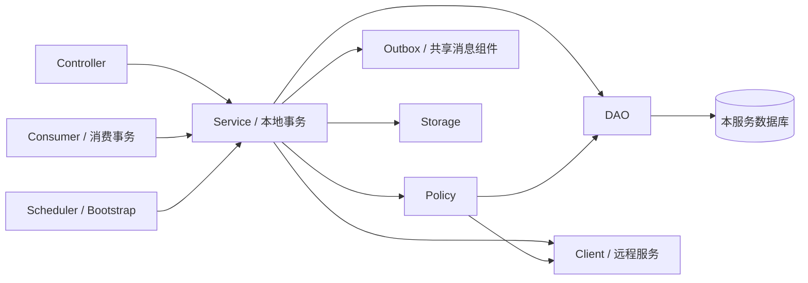

# 服务内部的分层调整方案

调研日期：2026-10-10。本文给出后续重构方案，尚未移动 Java 文件、修改依赖或改变业务行为。现状与逐类职责分别见 [项目结构总览](project-structure-overview.md)、[类功能索引](class-responsibilities.md)；技术栈核对见 [Spring Cloud 技术栈审计](spring-cloud-stack-audit.md)。

最新选型：后续数据层采用 MyBatis Mapper，数据库建立采用完整 MySQL SQL，详见 [数据库与 MyBatis 迁移调研](database-mybatis-migration-research.md)。本文的包归位表仍适用；下文 `*Dao` 是持久化能力的候选名称，实际实施可直接采用对应 `*Mapper`，无需再为每个 Mapper 增加一层 DAO 包装。

## 1. 与 SpringCloudDemo 对照后的结论

建议采用 `client/config/controller/dto/entity/dao/service` 为基础的分层结构，并按实际职责增加 `policy/messaging/storage/sse/metrics/bootstrap`。六个服务当前的 117 个主 Java 文件可以先归入这些包，再逐步抽离 SQL 和混合职责。应用启动类留在各服务根包 `com.amatrix.sic.<领域>`。

参考工程中有两类例子，不能把它们理解成每个模块都实现了完整七层：

| 参考模块 | 实际结构 | 本项目可借鉴的部分 |
| --- | --- | --- |
| [EurekaConsumer-8868](../../../SpringCloudDemo/EurekaConsumer-8868/src/main/java/org/example/eurekaconsumer8868) | `client/config/controller/entity`，Feign 接口独立；配置中还有负载均衡 RestTemplate/WebClient | 远程客户端与控制器、配置分开存放 |
| [NacosProvider-9011](../../../SpringCloudDemo/NacosProvider-9011/src/main/java/org/example/nacosprovider9011) | `controller/service/entity/dao`；`UserMapper` 配合 `resources/mapper/userMapper.xml` 使用 MyBatis | 控制器调用业务服务，服务调用数据访问层；数据模型有独立位置 |

SicProjectIS_cloud 当前使用 **JdbcTemplate + Flyway**，业务数据层尚未使用 MyBatis/JPA。本次后续选型明确为 MyBatis Mapper：将现有读写 SQL 转入 `resources/mapper`，接口放在 `dao` 包。包调整与数据层切换均保持现有业务表结构；Flyway 转完整 SQL 的步骤、旧库接管与初始化联动另见数据库迁移调研。

目前存在真正的职责混合：`InternalIdentityController` 直接查询统计 SQL；多个业务 Service、权限 Policy、消息 Consumer 和 Metrics 直接操作 JdbcTemplate。因此，仅移动到 `service` 包不能算完成业务分层。

## 2. 统一目录和依赖约定

以业务服务为例，按存在的职责创建目录，不预建空层：

```text
com.amatrix.sic.<领域>/
├── <领域>ServiceApplication.java
├── client/                 Feign 接口与远程调用适配
│   └── auth/               内部服务 Token 获取、缓存与请求头构造
├── config/                 Security、RabbitMQ、MinIO 等 Bean 配置
│   └── properties/         @ConfigurationProperties 类型
├── controller/             对外 HTTP 入口
│   └── internal/           /internal HTTP 入口
├── dto/                    HTTP 请求、响应及本服务应用用例参数
├── entity/                 本服务持久化数据模型
├── dao/                    MyBatis Mapper 接口、数据库投影和锁查询
├── service/                业务编排与事务边界
├── policy/                 权限判断与业务规则
├── messaging/consumer/     RabbitMQ 消费入口
├── storage/                对象存储适配，仅材料服务需要
├── sse/                    连接注册与推送，仅通知服务需要
├── metrics/                指标采集
└── bootstrap/              初始化任务
```

Workflow 的规模较大，可在层内按 `definition/runtime/review/form/business/saga` 分组；其他服务先保持较浅的结构。不要同时建立两套 `domain/service` 与 `service/domain` 目录体系。

| 层 | 负责什么 | 依赖约定 |
| --- | --- | --- |
| controller | 路由、请求校验、提取认证上下文、响应包装 | 调用 service；不直接写 SQL、发送 Outbox、调用 MinIO |
| service | 业务用例、跨 DAO 协作、事务、远程协作 | 调用 dao/client/policy/storage/公共消息组件；不依赖 controller |
| dao | Mapper/XML 查询、写入、锁与数据库投影 | 只访问本服务数据库；不调用 Feign、不决定用户是否有业务权限 |
| entity | 内部持久化记录，例如用户账户、材料版本 | 不直接作为公共接口；密码哈希等字段不能被响应序列化暴露 |
| dto | 请求、响应和用例数据 | 与数据库模型分开；先整体移动 `*Dtos`，后续按用例拆分内部 record |
| client | 其他服务的 HTTP 契约、认证适配 | 服务名和 contextId 保持稳定；不访问其他服务数据库 |
| policy | 权限与状态规则 | 查询必要的本地 DAO/远程访问接口，返回或拒绝判定；不把业务规则塞到 DAO |
| messaging.consumer | 接收事件、解析 Envelope、触发消费用例 | 去重标记、业务写入与 Outbox 仍在同一事务内 |
| config/properties | Bean 装配、配置绑定 | 不承担业务用例；Feign 专用配置只作用于指定客户端 |
| scheduler/bootstrap/metrics | 定时触发、初始化、指标 | 调用 service 或只读 DAO；不重复实现业务状态机 |



`entity` 可以使用 Java record 或普通类，不需要为了分层增加 ORM 注解。单表读写按需要建实体，多表聚合使用明确的查询投影；复杂查询不强行先拼成大量实体再合并。`Map<String,Object>` 响应可以逐步换成 DTO，但必须保留前端字段名、空值、时间及数字序列化行为。

业务服务暂时保留具体 `@Service` 类，不为每个类机械增加同名接口和 `impl`。只有需要替换实现、建立稳定边界时再引入接口。下面新 DAO/Entity 名称是候选拆分单元，不代表必须每张表都建一套类。

## 3. 六个服务的现有类归位表

表中类型均已存在；目标为服务根包下的子包。表中共覆盖 117 个主源码文件。新提取的 DAO、Entity 另列在各节说明中；它们目前尚不存在。

### 3.1 gateway-service：11 个主文件

根包：`com.amatrix.sic.gateway`。这是 WebFlux 网关，重点是过滤器、鉴权与错误响应，业务 `entity/dao/service` 不适用。

| 现有类型 | 目标子包 |
| --- | --- |
| `GatewayServiceApplication` | 根包 |
| `GatewaySecurityConfig` | `config` |
| `GatewaySecurityProperties`, `GatewayRateLimitProperties` | `config.properties` |
| `SessionValidityAuthorizationManager` | `security` |
| `GatewayRateLimitWebFilter`, `GatewayRequestLoggingFilter`, `SseTokenRelayWebFilter`, `TraceIdWebFilter` | `filter` |
| `GatewayJsonErrorHandler`, `GatewayErrorWriter` | `error` |

**先处理访问性再分包。** `GatewayErrorWriter` 当前是包内可见类，`write` 也包内可见；配置和限流过滤器跨包后无法调用。可将其整理成公开且 API 很小的错误响应组件，或公开明确的静态写入入口。其他辅助方法保持原来的最小可见性。

保留 Reactor 非阻塞调用、过滤器顺序、Redis 会话检查与限流异常行为、SSE query Token 转请求头逻辑。不要在 Gateway 引入同步 Feign/JDBC。验收重点：原有安全、限流、响应透传及 SSE Token 测试。

### 3.2 iam-service：18 个主文件

根包：`com.amatrix.sic.iam`。先完成账号、组织权限、专家资质三组职责的归位。

| 现有类型 | 目标子包 |
| --- | --- |
| `IamServiceApplication` | 根包 |
| `AuthController`, `IamAdminController`, `ExpertQualificationController` | `controller` |
| `InternalIdentityController` | `controller.internal` |
| `JwkController` | `controller` |
| `AuthApplicationService`, `IamAdminService`, `ExpertQualificationService` | `service` |
| `IamRepository` | `dao` |
| `IamDtos` | `dto` |
| `IamSecurityConfig` | `config` |
| `IamJwtProperties`, `BootstrapAdminProperties`, `ServiceTokenProperties` | `config.properties` |
| `JwtTokenIssuer`, `RsaKeyProvider` | `security` |
| `BootstrapAdminInitializer` | `bootstrap` |

第二阶段建议提取：

| 提取单元 | 来源与职责 |
| --- | --- |
| `UserDao` 或先保留 `IamRepository` | 用户查询、账号状态、认证版本、角色/权限装载；先保持现有方法签名 |
| `DepartmentDao`, `RolePermissionDao`, `ExpertQualificationDao` | 从管理/资质服务抽出 SQL，保存现有唯一性和关联约束 |
| `IamOverviewDao` + `IamOverviewService` | 从内部 Controller 移出统计查询；输出仍为共享 `IamOverviewStats` |
| `InternalIdentityService` | 内部用户摘要与服务 Token 用例；Controller 保留 HTTP 提取，认证校验放在明确的用例/安全边界 |
| `UserAccountEntity`, `DepartmentEntity`, `RoleEntity`, `PermissionEntity`, `ExpertQualificationEntity` | 持久化模型；认证角色集合可以是查询投影，不必等同单表实体 |

`IamRepository` 内部的用户记录不能简单挪到 HTTP DTO 目录，尤其应隔离密码哈希。服务 Token、JWT/JWK、Redis 会话撤销与数据库认证版本更新的职责保持清晰；事务和事件写入顺序不因分包而变化。当前没有远程 Feign 接口，无需创建 `client` 空包。

### 3.3 project-service：23 个主文件

根包：`com.amatrix.sic.project`。区分项目读模型、授权管理、申请 Saga、审计和快照消费。

| 现有类型 | 目标子包 |
| --- | --- |
| `ProjectServiceApplication` | 根包 |
| `ProjectController`, `ProjectAdminController`, `ProjectAuditController`, `ProjectAuthorizationController` | `controller` |
| `InternalProjectController` | `controller.internal` |
| `ProjectQueryService`, `ProjectAuthorizationService`, `ProjectAuditService` | `service` |
| `ProjectApplicationSagaService` | `service.saga` |
| `ProjectAccessPolicy` | `policy` |
| `ProjectDtos` | `dto` |
| `IamDirectoryClient`, `ServiceTokenClient`, `WorkflowSagaClient` | `client` |
| `InternalTokenProvider` | `client.auth` |
| `ProjectUserDirectory` | `service.directory` |
| `ServiceClientProperties` | `config.properties` |
| `ProjectSnapshotMessagingConfiguration` | `config` |
| `ProjectExpertAccessEndedConsumer`, `ProjectUserSnapshotConsumer`, `ProjectWorkflowLifecycleConsumer` | `messaging.consumer` |
| `ProjectSagaMetrics` | `metrics` |

`ProjectUserDirectory` 同时使用本地用户快照和 IAM 查询，属于目录解析应用服务，不能因为名字中有 Directory 就归为纯 Feign 接口。

第二阶段建议提取 `ProjectDao`、`ProjectMemberDao`、`ProjectGrantDao`、`ApplicationSagaDao`、`UserSnapshotDao`、`AdminOperationLogDao`，必要时增加 `ProjectQueryDao` 承接列表/概览投影。对应实体以项目、成员、授权、Saga 状态、用户快照和审计记录为边界；权限 Policy 从 DAO 读取范围，业务拒绝逻辑继续保留在 Policy/Service。

三个 Consumer 可调用独立的快照/生命周期处理服务，将 SQL 移到 DAO；不要将不同消息语义全塞入通用的 `saveEvent`。`ProjectSagaMetrics` 的查询也归入只读 DAO。

申请 Saga 的本地状态转换、调用 Workflow 创建/查询/补偿、恢复扫描和 Outbox 必须保持原有边界。分层不会把跨服务操作变成单个数据库事务。`ProjectQueryService.nullableLong` 是包内可见的映射辅助方法，跨包依赖应归入 mapper/DAO；其 `roles/number` 当前是公开静态方法，后续可提到认证上下文转换组件，减少其他层依赖查询服务。

### 3.4 workflow-service：38 个主文件

根包：`com.amatrix.sic.workflow`。规模最大，采用“层内按能力分组”，先拆出定义、运行时、评审、表单、结构化业务、Saga。

| 现有类型 | 目标子包 |
| --- | --- |
| `WorkflowServiceApplication` | 根包 |
| `WorkflowDefinitionController`, `WorkflowRuntimeController`, `ModuleBusinessDataController`, `ExpertReviewController`, `NodeFormController`, `NoticeController`, `StructuredBusinessController` | `controller`（需要时再按能力细分） |
| `InternalApplicationSagaController` | `controller.internal` |
| `WorkflowDefinitionService` | `service.definition` |
| `WorkflowRuntimeService`, `WorkflowTransitionActionService` | `service.runtime` |
| `ExpertReviewService` | `service.review` |
| `NodeFormService` | `service.form` |
| `NoticeService`, `StructuredBusinessService` | `service.business` |
| `ApplicationSagaWorkflowService` | `service.saga` |
| `ExpertReviewViewRepository` | `dao.review` |
| `WorkflowDtos`, `ExpertReviewDtos` | `dto`（后续按用例拆分） |
| `FlowableBpmnDefinitionParser` | `workflow.parser` |
| `WorkflowBpmnParseResult` | `workflow.model` |
| `WorkflowDefinitionCatalog`, `WorkflowDefinitionNavigator` | `workflow.definition` |
| `ModuleSuccessorPolicy`, `WorkflowOperationPolicy`, `WorkflowProjectAccessPolicy` | `policy` |
| `ProjectAccessClient`, `MaterialReservationClient`, `WorkflowServiceTokenClient` | `client` |
| `WorkflowInternalTokenProvider` | `client.auth` |
| `WorkflowClientProperties` | `config.properties` |
| `WorkflowSnapshotMessagingConfiguration` | `config` |
| `ExpertReviewCompletedConsumer`, `WorkflowProjectAuthorizationConsumer`, `WorkflowProjectLifecycleConsumer`, `WorkflowUserSnapshotConsumer` | `messaging.consumer` |
| `WorkflowAssetInitializer` | `bootstrap`，须先完成下述解耦 |

**定义初始化必须先解耦。** `WorkflowDefinitionService` 正在调用 `WorkflowAssetInitializer` 的 `ASSET_NAMES/BASE_PATH/read/persistModel` 包内成员。目标应提取可复用的资产读取组件（例如 `workflow.definition.WorkflowAssetCatalog`）和 `dao.definition.WorkflowDefinitionDao` 的模型写入操作，再让启动初始化和定义服务共同依赖它们。机械移动阶段可暂时把定义服务与初始化类留在同一包，不能直接把初始化类搬走导致编译失败，也不宜通过把所有内部成员公开来维持倒置依赖。

第二阶段建议按能力提取 DAO 和模型：

| 能力 | 候选 DAO / Entity / DTO |
| --- | --- |
| definition | DefinitionDao：定义、节点、迁移配置与模型写入；定义实体与解析模型分开 |
| runtime | ModuleInstanceDao、WorkflowTaskDao、StateRecordDao：运行实例、任务、状态记录与锁查询 |
| review | ExpertReviewDao：批次、分配、评分；已有 ViewRepository 先保留，逐步输出 DTO/查询投影 |
| form | NodeFormDao：表单数据与定义读取；表单 JSON 本体保持独立格式 |
| business | ApplicationDao、ContractDao、AcceptanceDao，以及按使用情况抽出的 Achievement/SettlementDao；公告另设 NoticeDao |
| saga / snapshot | ApplicationSagaDao、ProjectSnapshotDao、UserSnapshotDao、材料引用查询单元 |

`WorkflowRuntimeService` 应先抽 SQL，再抽运行时职责；不是把 800 多行代码机械拆成相互调用的工具类。可进一步建立任务处理、状态记录、迁移校验组件，但状态推进用例保留一个清晰的事务入口。数据库行锁、`expectedSeq` 校验、状态记录唯一性和后继模块冲突恢复属于一致性约束；DAO 拆分后仍需在同一连接/事务中执行。

保留材料预留/释放与迁移动作顺序、模块操作权限、评审完成驱动状态变更、快照与授权事件的消费去重。Flowable 当前用于解析 BPMN，实际运行状态由自定义服务管理；本次方案不切换成 Flowable RuntimeService。

### 3.5 material-service：20 个主文件

根包：`com.amatrix.sic.material`。业务存储和 MinIO 适配分开；生成单据、材料预留、异步删除属于三个可独立阅读的用例。

| 现有类型 | 目标子包 |
| --- | --- |
| `MaterialServiceApplication` | 根包 |
| `MaterialController` | `controller` |
| `InternalMaterialReservationController` | `controller.internal` |
| `MaterialApplicationService` | `service` |
| `MaterialReservationService` | `service.reservation` |
| `GeneratedDocumentService`, `GeneratedDocumentRenderer` | `service.document` |
| `ObjectDeletionService` | `service.cleanup` |
| `MaterialAccessPolicy` | `policy` |
| `MaterialProjectAccessClient`, `MaterialTokenClient` | `client` |
| `MaterialTokenProvider` | `client.auth` |
| `MaterialProperties`, `MaterialClientProperties` | `config.properties` |
| `MaterialMessagingConfiguration`, `MinioConfiguration` | `config` |
| `MinioObjectStorage` | `storage` |
| `GeneratedDocumentEventConsumer`, `MaterialReservationEventConsumer` | `messaging.consumer` |
| `MaterialCleanupMetrics` | `metrics` |

第二阶段建议提取 `MaterialDao`、`MaterialVersionDao`、`MaterialTypeDao`、`MaterialReservationDao`、`GeneratedDocumentDao`、`ObjectDeletionJobDao`。实体包括材料、版本、预留、生成任务和删除任务；元数据 DTO 与上传文件流不能混成数据库 Entity。

MinIO 操作集中在 `storage`；如果测试替换或存储切换确有需要，可引入 `ObjectStorage` 接口。Renderer 保持纯渲染职责；单据元数据/状态由生成服务与 DAO 管理。

删除用例必须保留：本地事务中软删除元数据、记录对象删除任务及事件，随后异步清理对象。不要将 MinIO 删除移进数据库事务，造成回滚后文件已经消失。已生成材料、已预留/确认材料的删除限制也必须保留。若拆出 scheduler，让它调用事务服务 Bean，避免同类自调用导致事务代理失效。

### 3.6 notification-service：7 个主文件

根包：`com.amatrix.sic.notification`。以消息入口、持久化投递、SSE 连接三部分为核心，适合作为首个业务服务分层试点。

| 现有类型 | 目标子包 |
| --- | --- |
| `NotificationServiceApplication` | 根包 |
| `SseController` | `controller` |
| `NotificationEventConsumers` | `messaging.consumer` |
| `NotificationMessagingConfiguration` | `config` |
| `PendingNotificationDeliveryService` | `service` |
| `SseConnectionRegistry` | `sse` |
| `NotificationMetrics` | `metrics` |

第二阶段抽出 `PendingNotificationDao`、`PendingNotificationEntity` 和必要的通知响应 DTO；Consumer 中的持久化、待投递逻辑进入明确的通知处理服务。连接集合是内存状态，留在 SseConnectionRegistry，不当作数据库实体。

保留实例级匿名队列、实例级消费者身份、持久化待投递与在线推送的协作方式；不要顺手改成“多个实例共用一个竞争队列”，否则连在另一个实例的浏览器可能接不到事件。当前 SSE 没有浏览器业务确认机制，重构不能对外声称达到端到端 exactly-once。

## 4. platform 模块的调整边界

这些模块承担公共库、基础设施应用或工具职责，不能套用业务服务的完整目录。

| 模块 | 后续组织建议 |
| --- | --- |
| cloud-contracts | 保持共享 API/Event record 的公开全限定名稳定；需要时再按 `api/event/identity/project/workflow/material` 分组。它不是各服务的 Entity 仓库，不放数据库模型 |
| cloud-security | 可分为 `autoconfigure/properties/context/annotation/web/feign`；首轮业务服务重构可不动公开类型，避免六个服务同时换公共依赖 |
| cloud-messaging | 可分为 `autoconfigure/outbox/consumer/metrics`；OutboxRepository 是数据访问层，不必仅为命名统一改成 Dao；稳定库入口与消费事务语义 |
| discovery-server | 单个启动类和 Eureka 配置足够；无需 controller/service/dao |
| config-server | 单个启动类和 `resources/config/*.yaml` 足够；这个资源目录与 Java 的 `config` 包含义不同 |
| integration-tests | 更新跨服务 Controller import、契约基类/测试辅助类型引用；按 API/infra 测试职责组织即可 |
| migration-tool | 当前主要是一体化命令行迁移工具；需要扩展时按 `cli/service/storage/report` 拆分，保持重复执行和迁移报告行为 |
| dlq-recovery-tool | 启动类留根包，Properties 进 `config.properties`，ReplayService 进 `service`；增加代码时再提取消息适配，保持重放校验 |

如果移动公共自动配置类，必须同步修改这两个注册文件中的全限定名：

- [cloud-security 自动配置注册](../platform/cloud-security/src/main/resources/META-INF/spring/org.springframework.boot.autoconfigure.AutoConfiguration.imports)
- [cloud-messaging 自动配置注册](../platform/cloud-messaging/src/main/resources/META-INF/spring/org.springframework.boot.autoconfigure.AutoConfiguration.imports)

## 5. 包迁移时必须处理的实际耦合

| 耦合点 | 后续处理 |
| --- | --- |
| 默认扫描 | 启动类留服务根包；确认 ComponentScan、ConfigurationPropertiesScan 和 Feign 扫描包含新子包。Feign 可显式列 `clients` 或指定扫描包 |
| Feign 配置范围 | 专用配置不要被普通组件扫描当成所有客户端的全局默认配置；保持 `name/contextId`、接口路径、认证头及序列化契约 |
| SpEL Bean 名称 | 保留 Project/Workflow 各自的 `projectAccessPolicy`、Workflow 的 `workflowOperationPolicy`、Material 的 `materialAccessPolicy` 与公共 `actorContextResolver`；同名 policy 属于不同进程，无需为了分包强行改名 |
| 权限注解参数 | 保留 `projectId/moduleInstanceId` 等注解引用的参数名和 `maven.compiler.parameters=true`；包调整不等于权限表达式无需验证 |
| 包内访问 | 处理 GatewayErrorWriter、WorkflowAssetInitializer、ProjectQueryService.nullableLong；逐处决定公共边界，不批量改成 public |
| 事务代理 | 新服务互调必须经过 Spring 代理；同类自调用不会自动建立原本需要的事务/方法权限拦截。TransactionTemplate 与现有局部事务范围要逐用例保留 |
| 消费去重 | ConsumedEventGuard 标记和业务写入须在原有消费事务中；不要先提交去重，再执行会失败的业务 |
| Bean / Queue 装配 | 保留显式 Bean 名、Qualifier、队列名、交换机和 routing key；移动配置类不改变这些约定 |
| 测试包与构造器 | 测试有包内可见 Controller 方法、构造器和辅助类型引用；同步测试包或使用完整构造器/Mock，避免只让主源码编译而测试无法编译 |
| 契约生成 | 服务 POM 指定 ContractBase 全限定名；可先保持 `*.contract` 包不动，否则同步插件配置与 import |
| 跨模块 API 测试 | FrontendApiSurfaceTest 显式 import 14 个 Controller 并反射其方法，须更新 import；它不是自动发现新 Controller 的文件扫描器 |
| 资源 | 保持 Flyway、BPMN、表单、模板与 native Config Server 的资源路径；Java 分包无需移动资源 |

Feign 扫描和专用配置作用域的规则依据 [OpenFeign 官方文档](https://docs.spring.io/spring-cloud-openfeign/reference/spring-cloud-openfeign.html)。

## 6. 建议实施顺序与验收

将结构迁移、职责提取和技术栈补齐分成可独立回滚的提交/PR，避免在同一次重构中改变 API 或增加熔断语义。

| 阶段 | 范围 | 完成标准 |
| --- | --- | --- |
| 0：基线 | 固定当前提交、确认测试环境、记录 API/事件/配置与业务关键行为 | 保存既有测试实际运行结果；本文中的依赖审计不替代测试基线 |
| 1：包归位 | 每次一个服务，只移动文件并修复 import/扫描/访问边界；推荐 Notification → Gateway → IAM → Project → Material → Workflow | 主/测试源码可编译，契约和相关既有测试通过；公共库全限定名先保持稳定 |
| 2：DAO 与模型 | 每次一个业务能力，从 JDBC 调用处抽出 DAO，再建立必要 Entity/DTO | Controller 无 SQL；Service 保留用例/事务；Consumer 不再混合大段业务 SQL；Metrics 使用只读 DAO |
| 3：复杂用例 | 分拆 Workflow 运行时、IAM 管理、Project 授权等大类；消除服务依赖启动初始化类 | 一致性与权限测试证明行为保持；逐步减少 Map 响应，不批量修改 JSON |
| 4：公共库整理 | 确有收益时再移动公共库包、同步自动配置入口与所有调用者 | 自动配置测试与全 reactor 验证通过，避免只在一个应用中验证 |
| 独立事项：Resilience4j | 另行实施熔断与降级，详见技术栈审计 | 故障注入证明 OPEN/恢复与各类 fallback 行为正确；不与目录移动绑在一起 |

阶段 1 可以暂时保留现有 Service 里的 SQL，明确将其记为阶段 2 待处理项；终态在线数据读写采用 Mapper。不能用“目录已分层”宣称数据层切换也完成。阶段 2 完成后再把“不允许 Controller/Service/Consumer/Metrics 直接注入 JdbcTemplate”作为可自动校验的依赖规则；工具、初始化校验或测试夹具的例外逐项列明。

后续实际实施时，至少覆盖以下已有验证：

- Gateway：安全、Redis 会话、错误/限流、响应透传、SSE Token。
- IAM：认证流程、JWT、安全配置与 AuthContractBase 对应契约。
- Project：访问策略、MethodSecurityProxyTest、查询、申请 Saga、专家授权结束消费。
- Workflow：WorkflowExpectedSequenceConcurrencyTest、WorkflowOperationPolicyTest、WorkflowDefinitionModelTest、ModuleSuccessorPolicyTest、表单与 Saga 补偿。
- Material：MaterialDeletionTransactionTest、MaterialReservationServiceTest、ObjectDeletionServiceTest、文档渲染。
- Notification：NotificationEventConsumersTest、PendingNotificationDeliveryServiceTest 及 SSE 契约。
- 公共库与集成：去重/Outbox/自动配置/上下文传播测试、FrontendApiSurfaceTest；依赖 Docker 的 InfrastructureIntegrationTest 按环境执行，未执行应明确记下。

可在云工程根目录运行 `mvn verify` 作全 reactor 验证；分服务检查需使用 `-pl <模块> -am` 包含依赖，并在最终阶段覆盖跨模块集成测试。不要用 `-DskipTests` 的编译成功作为重构验收。源码文件数可能因 DAO/DTO 拆分增长，不能继续把 117 当作完成后的固定指标。

本次仅调研和编写方案；已核对现有源码归位清单与文档链接，未运行重构后的测试，因为还没有实施重构。
