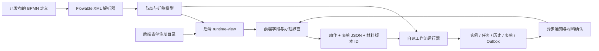
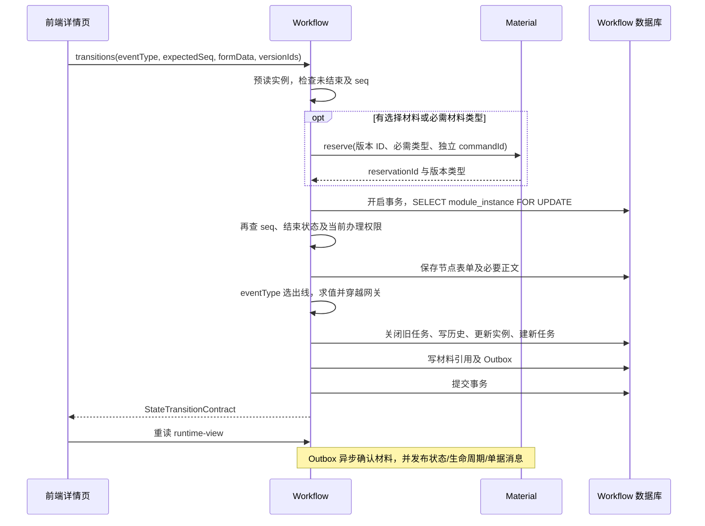
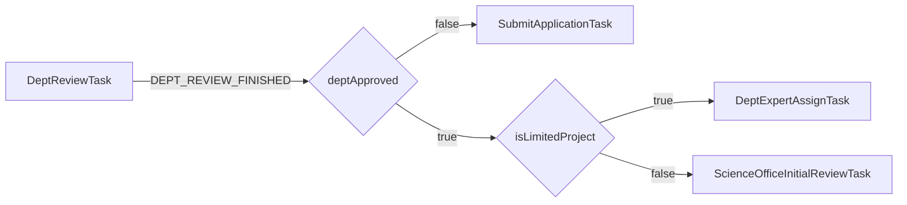

本文根据 2026-10-14 工作区中的源码整理，关注 `services/workflow-service` 与 `SicProjectIS_fronted` 的实际提交和推进机制。结论来自源码、Mapper SQL、内置 BPMN 和已有测试用例的交叉核对；没有连接运行中的数据库，也没有执行端到端请求。

**1. 对现有理解的校正**

“BPMN 定义流程，前端填写节点数据，后端检查后推进状态机”基本正确。实际实现还需要补充四点：

- Flowable 用于把 BPMN XML 解析成模型；业务实例由自建的 `WorkflowRuntimeService` 推进，没有调用 Flowable 的 RuntimeService、TaskService 来运行实例。
- BPMN 定义节点、角色、材料要求、迁移事件、网关条件和单据生成配置。具体表单代码、业务数据分类、字段及 JSON 结构，还由后端 Java 注册目录和前端 TypeScript 共同定义。
- 普通节点通过显式 `transitions` 请求推进。单独保存表单、上传附件不会自动推进；专家评分完成是另一条事件驱动的自动推进路径。
- 流程状态由后端决定。前端读取后端当前运行视图来展示表单和动作，再把用户输入交给后端；前端没有维护另一套独立运行的状态机。

完整模型可以表达为：



核心代码：[WorkflowRuntimeService](../services/workflow-service/src/main/java/com/amatrix/sic/workflow/service/runtime/WorkflowRuntimeService.java)、[FlowableBpmnDefinitionParser](../services/workflow-service/src/main/java/com/amatrix/sic/workflow/workflow/parser/FlowableBpmnDefinitionParser.java)、[NodeFormService](../services/workflow-service/src/main/java/com/amatrix/sic/workflow/service/form/NodeFormService.java)。

**2. 状态机的运行单位和持久化数据**

运行单位是 `module_instance`，即某个项目的某个流程模块实例。当前模块类型有 `APPLICATION`、`CONTRACT`、`ACCEPTANCE`。一个项目通常依次经历申请、合同、结题三个模块；一个模块结束不等于整个项目结束。

| 数据                                                                             | 作用                                                                                                                                                     |
| -------------------------------------------------------------------------------- | -------------------------------------------------------------------------------------------------------------------------------------------------------- |
| `workflow_definition`                                                          | 定义版本、发布状态、原始 BPMN XML、解析模型 JSON。                                                                                                       |
| `workflow_node_config` / `workflow_transition_config`                        | 节点和连线的持久化配置，供节点配置 ID 关联和定义查询等用途。                                                                                             |
| `module_instance`                                                              | 当前节点`current_node_id`、业务状态 `current_state`、序号 `current_seq`、轮次 `current_round`、结束标记 `finished`，并关联 `definition_id`。 |
| `workflow_task`                                                                | 当前谁可以办理：节点、具体指派人、候选角色、轮次、OPEN/COMPLETED 状态。                                                                                  |
| `state_record`                                                                 | 每次推进的事件、起止节点/状态、结果、意见、操作人和序号。                                                                                                |
| `node_form`                                                                    | 节点表单 JSON，通常按模块、表单键和轮次保存。                                                                                                            |
| `project_application` / `contract_form` / `acceptance_form`                | 申请、合同、结题正文；申请还维护标题、限项标记等可查询列。                                                                                               |
| `workflow_material_reference`                                                  | 某次成功迁移使用了哪些具体文件版本，关联模块和迁移序号。                                                                                                 |
| `expert_review_batch` / `expert_review_assignment` / `expert_review_score` | 专家评审批次、每个专家的任务、分项评分及聚合结果。                                                                                                       |
| `outbox_event`                                                                 | 与本地业务更新同事务写入、之后异步发送的消息。                                                                                                           |

`nodeId` 是流程图中的节点编码，例如 `DeptReviewTask`；`stateCode` 是业务状态，例如 `APPLICATION_DEPT_REVIEWING`。`seq` 每成功推进一次加一；`round` 用于区分退回后再次办理的轮次。数据库另有 `(module_instance_id, seq)` 的状态历史唯一约束，以及项目与模块类型的唯一索引。

运行时并不是每次读取 `workflow_transition_config` 来选路径。`WorkflowDefinitionCatalog.model(definitionId)` 读取该定义保存的 BPMN XML，重新解析成模型，再交给导航器。

依据：[WorkflowRuntimeMapper.xml](../services/workflow-service/src/main/resources/mapper/workflow/WorkflowRuntimeMapper.xml)、[WorkflowDefinitionCatalog](../services/workflow-service/src/main/java/com/amatrix/sic/workflow/workflow/definition/WorkflowDefinitionCatalog.java)、[运行表结构](../services/workflow-service/src/main/resources/db/migration/V2__workflow_domain.sql)、[项目模块唯一索引](../services/workflow-service/src/main/resources/db/migration/V101__unique_project_module.sql)。

**3. BPMN 扩展具体定义了什么**

| 扩展                       | 主要字段                                                                                  | 实际用途                                                      |
| -------------------------- | ----------------------------------------------------------------------------------------- | ------------------------------------------------------------- |
| `rm:processConfig`       | `processKey`、`moduleType`、`versionNo`、`status`                                 | 标识流程及所属模块、版本。数据库发布状态由上传/发布逻辑管理。 |
| `rm:workflowNode`        | `stateCode`、`nodeType`、`candidateRoleCode`、`operationMode`、责任人及被代录主体 | 将图节点映射为运行状态及候选办理角色，提供展示元数据。        |
| `rm:materialRequirement` | 材料类型、提交时机、必填、数量、文件类型、大小、校验键                                    | 描述节点材料要求；推进时提取必需材料类型。                    |
| `rm:transition`          | 起止节点、`eventType`、`result`、`conditionType/Key/Value`、`actionKeys`          | 选择动作，穿越网关，记录结果，检查动作配置。                  |
| `rm:documentConfig`      | 生成时机、模板、输出材料类型、快照配置                                                    | 节点完成或流程结束时发出异步单据生成命令。                    |

例如申请节点的扩展是：

```xml
<rm:workflowNode
  stateCode="APPLICATION_DRAFT"
  nodeType="USER_TASK"
  candidateRoleCode="PROJECT_LEADER"
  operationMode="SELF_OPERATE" />
<rm:materialRequirement
  materialTypeCode="PROJECT_APPLICATION_FORM"
  requirementTiming="BEFORE_SUBMIT"
  required="true"
  minCount="1" />
```

它说明负责人在申请草稿状态需要提交申请书附件。申请标题、研究背景、预算等表单字段及其 JSON 层级，并没有由这段 XML 定义。

业务运行使用的是 `rm:workflowNode.candidateRoleCode`。BPMN 中同时出现的 `flowable:candidateGroups`、`flowable:assignee` 不会在这里由 Flowable 引擎计算任务指派。例如文件中部分 Flowable 角色名称与 `SCIENCE_ADMIN`、`DEPT_ADMIN` 并不相同，运行器采用后者。

还有一些扩展字段属于原设计元数据：例如 `processConfig` 中写了 `taskTable="task_instance"`、`stateRecordTable="module_state_record"`，但解析后的 `ProcessConfig` 根本没有这些字段，实际 SQL 固定操作 `workflow_task`、`state_record`。不能根据 XML 中的表名判断现有落库行为。

依据：[项目申请 BPMN](../services/workflow-service/src/main/resources/workflows/bpmn_auxiliary_tags_augmented/项目申请_辅助标签版.bpmn)、[解析模型结构](../services/workflow-service/src/main/java/com/amatrix/sic/workflow/workflow/model/WorkflowBpmnParseResult.java)、[解析器](../services/workflow-service/src/main/java/com/amatrix/sic/workflow/workflow/parser/FlowableBpmnDefinitionParser.java)。

**4. 定义如何进入运行、实例如何启动**

定义上传后解析并校验，保存为 `DRAFT`；即使上传 XML 的扩展写着 `status="ACTIVE"`，上传接口也不会直接发布。发布时将当前定义置为 `ACTIVE/published=true`，同模块其他已发布定义被停用。

新实例使用该模块当前已发布定义；实例保存 `definition_id`。已有实例后续按照自己的定义 ID 加载模型，发布新版本不会自动把已有实例切到新版本。这里的关联是定义 ID，不是每个实例各自保存完整模型副本。

默认启动依赖已经安装的 SQL 定义种子；`WorkflowAssetInitializer` 主要检查定义是否存在。显式开启 `sic.workflow.assets.bootstrap-if-missing` 才尝试补缺，不应理解为每次启动都用资源文件重建定义。

申请通过前端工作台的 `POST /api/project-applications/start` 启动：Project 创建项目并协调 Saga，再调用 Workflow 的内部申请 Saga 接口。Workflow 在本地事务中创建项目快照、申请正文、申请模块、初始任务、初始历史及 Outbox。

当前内置申请 BPMN 的开始连线是 `StartEvent → SubmitApplicationTask`，初始状态为 `APPLICATION_DRAFT`，`seq=1`、`round=1`。文件中存在“发布申报通知”节点，不代表申请实例先停在那里；实际入口要看开始连线。

已有项目的合同/结题模块还有 `POST /api/projects/{projectId}/module-instances` 入口，要求对应管理员及项目权限。该入口明确拒绝启动 APPLICATION。正常成功结束时，后继模块由后端自动创建，见第 10 点。

依据：[WorkflowDefinitionService](../services/workflow-service/src/main/java/com/amatrix/sic/workflow/service/definition/WorkflowDefinitionService.java)、[WorkflowAssetInitializer](../services/workflow-service/src/main/java/com/amatrix/sic/workflow/bootstrap/WorkflowAssetInitializer.java)、[ApplicationSagaWorkflowService](../services/workflow-service/src/main/java/com/amatrix/sic/workflow/service/saga/ApplicationSagaWorkflowService.java)、[WorkflowWorkbenchView.vue](../../SicProjectIS_fronted/src/views/WorkflowWorkbenchView.vue)。

**5. 前端如何知道展示什么、提交什么**

详情页先请求：

```http
GET /api/module-instances/{moduleInstanceId}/runtime-view
```

后端返回：

| 返回内容                    | 前端用途                                                       |
| --------------------------- | -------------------------------------------------------------- |
| `context`                 | 项目/模块/定义 ID、当前节点和状态、`currentSeq`、轮次等。    |
| `canOperate`              | 是否显示可办理行为、是否允许点击提交。后端写入口还会重新检查。 |
| `availableTransitions`    | 当前节点的出线动作；前端选择动作并提交其`eventType`。        |
| `materialRequirements`    | 展示附件要求、选择或上传具体版本。                             |
| `nodeForms`               | 表单代码、`dataKind`、`writeMode` 等注册元数据。           |
| `openTasks` / `history` | 当前任务、办理记录和流程展示。                                 |
| `taskConfiguration`       | 财务节点额外的办理配置就绪信息。                               |

具体表单对应关系由三部分组成：

1. 后端 `NodeFormService.definitions()` 硬编码注册 43 个表单，例如 `DEPT_APPLICATION_REVIEW_FORM` 对应 APPLICATION 的 `DeptReviewTask`，`dataKind=CHECK_ITEM`、`writeMode=HISTORY_RECORD`。
2. `forNode()` 先匹配模块类型，再匹配节点编码或状态编码，返回当前节点对应表单。
3. 前端 `nodeFormFields.ts` 按 `dataKind` 定义可编辑字段、字段类型、默认值和部分必填规则；`useNodeFormHelpers.ts` 将扁平表单组装为后端 JSON 结构。

当前 `WorkflowNodeWorkPanel` 默认选第一个非只读表单，没有将当前节点的所有可写表单自动组合成一次提交。一个节点能返回多个定义，例如结题材料节点，但正式迁移请求只有一个 `formCode` 和一个 `nodeFormData`。

详情页另外按实例关联的 `workflowDefinitionId` 读取 BPMN XML 和节点配置，用于图形及步骤展示。图形高亮、前端步骤状态都是后端运行信息的投影，图上的点击不直接修改运行状态。

依据：[runtimeView()](../services/workflow-service/src/main/java/com/amatrix/sic/workflow/service/runtime/WorkflowRuntimeService.java)、[表单目录](../services/workflow-service/src/main/java/com/amatrix/sic/workflow/service/form/NodeFormService.java)、[WorkflowDetailView.vue](../../SicProjectIS_fronted/src/views/WorkflowDetailView.vue)、[WorkflowNodeWorkPanel.vue](../../SicProjectIS_fronted/src/components/workflow/WorkflowNodeWorkPanel.vue)、[字段目录](../../SicProjectIS_fronted/src/utils/nodeFormFields.ts)、[请求组装](../../SicProjectIS_fronted/src/composables/useNodeFormHelpers.ts)。

**6. 保存表单、上传文件、正式提交是三类不同操作**

| 操作                                            | 数据如何保存                                             | 是否推进状态                                                                            |
| ----------------------------------------------- | -------------------------------------------------------- | --------------------------------------------------------------------------------------- |
| 详情页“保存本页草稿”                          | 页面组件中的`Map`，键为模块 ID + 当前序号 + 当前节点。 | 否；不发 HTTP，也不写 localStorage/sessionStorage，离开组件或浏览器刷新后不能靠它恢复。 |
| `PUT /api/node-forms/{formCode}`              | 保存 SINGLE_INSTANCE 表单，并同步对应正文草稿。          | 否。                                                                                    |
| `POST /api/node-forms/{formCode}/records`     | 新增 HISTORY_RECORD 表单记录。                           | 否；不能代替正式专家评分。                                                              |
| 结构化正文/成果接口                             | `StructuredBusinessService` 写相应业务表。             | 否。                                                                                    |
| 上传附件版本                                    | Material 服务保存文件及版本，返回`materialVersionId`。 | 否；上传后还要在正式请求中携带该版本。                                                  |
| `POST /api/module-instances/{id}/transitions` | 同事务保存本次表单及状态、任务、历史、材料引用、Outbox。 | 是。                                                                                    |
| 专家评分接口                                    | 保存个人评分、更新批次；全部提交后发出完成事件。         | 最后一个评分使批次完成后，异步触发工作流推进。                                          |

独立表单保存 API 存在，但当前主详情页的“保存本页草稿”没有调用它。`NodeFormsDebugView` 才调用独立表单读取、保存和历史记录接口。主详情页初始化普通表单时主要使用默认值和页面缓存，没有在 `loadDetail()` 中读取已保存的节点表单并完整回填。

正式提交结构由 [TransitionRequest](../services/workflow-service/src/main/java/com/amatrix/sic/workflow/dto/WorkflowDtos.java) 定义：

```json
{
  "eventType": "DEPT_REVIEW_FINISHED",
  "expectedSeq": 2,
  "result": "APPROVED",
  "remark": "形式审核通过",
  "materialVersionIds": [],
  "formCode": "DEPT_APPLICATION_REVIEW_FORM",
  "nodeFormData": {
    "projectId": 100,
    "moduleInstanceId": 200,
    "runtimeRecord": {
      "checkItem": {
        "itemCode": "DEPT_APPLICATION_REVIEW_FORM",
        "itemName": "Department review",
        "itemType": "REVIEW_RESULT",
        "itemValue": "true",
        "itemResult": "APPROVED",
        "required": true,
        "passed": true,
        "remark": "形式审核通过",
        "sortNo": 1,
        "moduleInstanceId": 200
      }
    }
  }
}
```

上述 ID、序号为示例。请求里没有前端指定的最终 `toState` 或最终目标节点，最终落点由后端根据当前节点和条件决定。

业务数据层级按 `dataKind` 区分，例如申请是 `applicationDraft.application/extension/detail`，合同是 `contractDraft.contract/extension`，审核是 `runtimeRecord.checkItem`，财务是 `projectRecord.financialSettlement`。

依据：[NodeFormController](../services/workflow-service/src/main/java/com/amatrix/sic/workflow/controller/NodeFormController.java)、[NodeFormsDebugView](../../SicProjectIS_fronted/src/features/node-forms/common/NodeFormsDebugView.vue)、[StructuredBusinessService](../services/workflow-service/src/main/java/com/amatrix/sic/workflow/service/business/StructuredBusinessService.java)、[前端材料 API](../../SicProjectIS_fronted/src/api/materials.ts)。

**7. 普通节点正式提交的后端执行顺序**

主链路是 `WorkflowRuntimeController.transition() → WorkflowRuntimeService.transition() → lockedTransition()`。



具体约束和写入行为：

1. `eventType` 必填。预读实例必须未结束；显式 `expectedSeq` 必须等于当前序号。兼容缺省时使用服务预读的序号，新前端明确传入当前序号。
2. 从当前 BPMN 节点提取 `required=true` 且时机为空或 `BEFORE_SUBMIT` 的材料类型，在 Workflow 事务外调用 Material 预留。
3. 每次预留尝试生成带 UUID 的独立 commandId。竞争失败时只释放自己的预留，避免撤销另一请求成功使用的租约。
4. 本地事务里对模块行 `FOR UPDATE`，重新检查是否结束、序号是否改变、用户是否仍可办理。权限来自 JWT 用户上下文，不能靠表单里的 userId 冒充。
5. 若传了 `nodeFormData`，先调用 `persistTransition()`，检查表单是否匹配当前节点及项目/模块上下文，然后保存数据。后续任何异常导致这些写入随迁移一起回滚。
6. 导航器解析目标节点；专家指派/评分相关动作还要检查相应批次状态。
7. 将模块全部 OPEN 任务标成 COMPLETED，写一条新 `state_record`，更新当前节点、状态、序号、轮次及结束标记。
8. 未结束则给最终落点建一个新 OPEN 任务。候选角色来自 BPMN；PROJECT_LEADER 任务会通过 Project 读取当前负责人并设置具体 assignee。
9. 有材料预留则写 `workflow_material_reference`，再写 `material.reservation.confirm` Outbox；始终写 `workflow.module-state-changed`。
10. 到终点则按后继规则创建下一模块，按配置排队单据生成和项目生命周期事件。相关 Workflow 本地写入仍处于同一事务。

同一序号的两个请求竞争时，行锁串行化后只有一个能把 seq 从 N 改为 N+1；另一个锁内看到序号改变，返回 409。它不会再自动把模块推进一步。

依据：[运行器](../services/workflow-service/src/main/java/com/amatrix/sic/workflow/service/runtime/WorkflowRuntimeService.java) 的 `transition()`（134 行）、`lockedTransition()`（384 行），以及 [权限策略](../services/workflow-service/src/main/java/com/amatrix/sic/workflow/policy/WorkflowOperationPolicy.java)。

**8. 表单如何落库，条件如何从数据中取得**

`NodeFormService.persistTransition()` 先按注册定义取业务子对象，再根据写入模式保存：

- SINGLE_INSTANCE：以 formCode 为键；同模块、同轮次重复保存更新原值。
- HISTORY_RECORD：使用 `formCode-随机串` 作为键，每次提交新增记录。
- 未注册的旧版或自定义节点：兼容用节点编码作为键保存，允许默认 `{moduleType}_FORM`。

`node_form.node_id` 这个列名容易误导：这里常保存 formCode 或带随机后缀的表单键，不一定是 BPMN 的节点编码。

保存节点 JSON 后还会按业务类别做特定写入：申请更新 `project_application` 的正文、标题、限项标记等；合同/结题更新对应轮次的正文；财务结算另写 `acceptance_financial_settlement` 并计算结余及执行率。普通审核、代录结果、用章等数据主要存节点 JSON；不能据此推断每种 `dataKind` 都自动落到独立结构化表。成果的专门结构化写入由独立成果接口负责。

条件取得逻辑在 `WorkflowRuntimeService.conditionValue()`，按顺序为：

| 优先级 | 数据来源                                                                                     |
| ------ | -------------------------------------------------------------------------------------------- |
| 1      | 本次`nodeFormData` 顶层若存在 `conditionKey`，直接取该值。                               |
| 2      | `isLimitedProject` 从 `project_application.limited_project` 读取。                       |
| 3      | `isSchoolLevelAcceptance` 从最近结题正文 JSON 的顶层读取。                                 |
| 4      | 条件键包含 expert 时，取模块最近一个 COMPLETED 专家批次的`final_result`，转成通过/不通过。 |
| 5      | `nodeFormData` 顶层 `approved`。                                                         |
| 6      | `nodeFormData` 顶层 `result`，转为布尔通过结果。                                         |
| 7      | 正式迁移请求外层`result`，转为布尔通过结果。                                               |

这个顺序意味着显式顶层同名字段也能覆盖上面列出的特定数据库来源。条件求值不递归寻找 `runtimeRecord.checkItem.passed` 等嵌套字段，也不是通用 JSONPath 或表达式引擎。

因此，当前前端审核表单把 `passed/itemResult` 放入嵌套对象时，`deptApproved` 之类条件通常最终靠迁移请求外层的 `result=APPROVED/REJECTED` 判定。不能认为“保存了 passed=true，任何后续请求都会自动读取它推进”。

正向结果白名单包括 `APPROVED`、`PASS`、`PASSED`、`RECOMMENDED`、`ACCEPTED`、`PROCESS_COMPLETED`、`SCHOOL_LEVEL`、`TRUE`。没有匹配的结果会按 false 处理。专家条件读取是模块范围最新完成批次，SQL 没有再限定当前节点和轮次；批次推进资格本身另有节点/轮次检查。

依据：[NodeFormService](../services/workflow-service/src/main/java/com/amatrix/sic/workflow/service/form/NodeFormService.java)、[NodeFormMapper.xml](../services/workflow-service/src/main/resources/mapper/workflow/NodeFormMapper.xml)、[conditionValue()](../services/workflow-service/src/main/java/com/amatrix/sic/workflow/service/runtime/WorkflowRuntimeService.java)、[请求组装](../../SicProjectIS_fronted/src/composables/useNodeFormHelpers.ts)。

**9. 状态如何转移：以二级单位审核为例**

导航器先找当前节点出线中 `eventType` 相等的第一条连线，然后沿目标继续走。如果遇到 GATEWAY，就计算它的所有出线条件，要求恰好一个命中；没有命中返回 400，多个命中返回 409。连续网关最多穿越 20 次。

当前代码只在穿越网关时调用条件求值；当前办理节点按事件选中的第一条连线本身没有再检查条件。普通节点若配置多个同 eventType 出线，也没有根据 result 再选择，而是取模型中的第一条。`availableTransitions` 返回当前出线，并未针对未提交的表单预先算出可成功执行的最终路径。

当前内置 BPMN 的审核是“一个办理事件进入网关，由网关选择通过/退回”：



| 本次审核结果及申请属性          | 经过的路径                                                           | 最终状态                              |
| ------------------------------- | -------------------------------------------------------------------- | ------------------------------------- |
| `result=REJECTED`             | DEPT_REVIEW_FINISHED → DEPT_REJECT                                  | APPLICATION_DRAFT                     |
| `result=APPROVED`，限项=true  | DEPT_REVIEW_FINISHED → DEPT_APPROVE → LIMITED_PROJECT_SELECTED     | APPLICATION_DEPT_EXPERT_ASSIGNING     |
| `result=APPROVED`，限项=false | DEPT_REVIEW_FINISHED → DEPT_APPROVE → NON_LIMITED_PROJECT_SELECTED | APPLICATION_SCIENCE_INITIAL_REVIEWING |

这三种情况前端提交的 `eventType` 都是 `DEPT_REVIEW_FINISHED`。前端改变审批结果，不是直接提交 `DEPT_APPROVE` 或网关最终目标。

一次 HTTP 提交可经过多个网关，但最终只写一条状态记录、seq 只加一；网关不是需要人工办理的持久化中间状态。状态记录保存外部提交事件和起止办理节点，不为每条网关出线各写一条记录。

退回时路径中出现 `eventType` 或配置 `result` 含 RETURN/REJECT 的连线，`nextRound()` 将轮次加一，再在新轮次创建负责人任务。这是基于完整路径的字符串规则；只把请求外层 result 设成 REJECTED，并不自动保证 round 加一。

状态历史的 result 优先保存请求外层 result，否则保存第一条出线的配置 result，未必是最后一条网关分支的 result。

依据：[WorkflowDefinitionNavigator](../services/workflow-service/src/main/java/com/amatrix/sic/workflow/workflow/definition/WorkflowDefinitionNavigator.java)、[申请 BPMN](../services/workflow-service/src/main/resources/workflows/bpmn_auxiliary_tags_augmented/项目申请_辅助标签版.bpmn)、[已有路径测试](../services/workflow-service/src/test/java/com/amatrix/sic/workflow/service/runtime/WorkflowDefinitionModelTest.java)。

**10. 专家评分与后继模块的自动推进**

专家评审使用专门接口，不靠把任意 `expertReview` JSON 塞入普通节点表单完成真实评分：

```text
POST /api/expert-reviews/batches
  → 创建本轮批次
POST /api/expert-reviews/batches/{batchId}/assignments
  → 指派专家并同步 Project 的临时授权
POST /api/module-instances/{id}/transitions
  → 完成指派节点，进入专家评分节点
POST /api/expert-reviews/assignments/{assignmentId}/scores
  → 每位专家提交本人评分
全部已指派专家提交
  → 批次 COMPLETED + final_result
  → Outbox: workflow.expert-review-completed
  → ExpertReviewCompletedConsumer
  → autoTransitionAfterExpertReviewComplete()
  → 锁内确认节点/轮次，推进到评审汇总节点
汇总节点提交
  → 通过专家结果网关，进入下一步骤或退回
```

批次完成判断目前是“实际指派人数 > 0，提交人数 >= 实际指派人数”，没有把 `expectedExpertCount/minExpertCount` 作为这段完成判定的门槛。有效评分另行筛选、平均，满足配置时去最高最低分；按 passScore/recommendScore 得到 PASSED/RECOMMENDED/REJECTED。

自动推进重新检查模块未结束、批次已完成、当前轮次及评审节点匹配，找到当前节点的评审提交事件，再复用 `lockedTransition()`。它用系统上下文执行，跳过普通用户办理权限检查，也没有走普通入口的材料预留步骤。

成功终态的跨模块规则在 Java 中：

| 当前模块终态         | 后续行为                                             |
| -------------------- | ---------------------------------------------------- |
| APPLICATION_APPROVED | 创建/复用 CONTRACT 模块，项目阶段切向 CONTRACT。     |
| CONTRACT_APPROVED    | 创建/复用 ACCEPTANCE 模块，项目阶段切向 ACCEPTANCE。 |
| ACCEPTANCE_ACCEPTED  | 不建下一模块，发布 PROJECT_FINISHED。                |
| ACCEPTANCE_REJECTED  | 无后继，发布 ACCEPTANCE_REJECTED。                   |

下一模块创建在 Workflow 本地迁移事务中，Project 的项目阶段通过生命周期事件异步同步。另有恢复任务补建缺失后继、重新核对负责人待办、回收离开评审节点后的专家访问。

依据：[ExpertReviewService](../services/workflow-service/src/main/java/com/amatrix/sic/workflow/service/review/ExpertReviewService.java)、[完成事件消费者](../services/workflow-service/src/main/java/com/amatrix/sic/workflow/messaging/consumer/ExpertReviewCompletedConsumer.java)、[ExpertReviewPanel.vue](../../SicProjectIS_fronted/src/components/workflow/ExpertReviewPanel.vue)、[ModuleSuccessorPolicy](../services/workflow-service/src/main/java/com/amatrix/sic/workflow/policy/ModuleSuccessorPolicy.java)。

**11. 材料一致性、消息和前端刷新**

文件二进制先通过 multipart 上传到 Material，Workflow 正式提交只收 `materialVersionIds`。Material 预留检查版本存在且未删除、属于当前项目，并覆盖所需材料类型；租约为 15 分钟。Workflow 成功提交后写版本引用，Outbox 再异步确认预留。失败释放本次租约，释放失败由到期清理兜底。

这是跨服务的预留/确认协调，本地提交和材料确认不是一个数据库事务。HTTP 成功时 Workflow 的状态已经提交，材料确认、单据生成、项目阶段同步、通知可能稍后完成。

前端上传成功会自动选中新版本；主详情页提交前检查必需材料是否选了当前版本。但 Material 的预留查询只检查未删除，没有校验 `isCurrent`，也没有把 BPMN 的 minCount/maxCount、allowedFileTypes/maxFileSizeMb、validatorKey 全部作为迁移校验执行。上传服务自身的规则应另行区分。

状态刷新链为：

```text
Workflow 本地状态提交 + Outbox
  → workflow.module-state-changed
  → Notification 保存 pending_notification、发送 notification.live
  → SSE MODULE_STATE_CHANGED
  → 前端重新 GET runtime-view
```

主详情页提交成功后会主动重读；失败也会重读状态，不自动重试写请求。草稿缓存按 seq/节点区分，状态没改变时可保留本页输入，若已经推进则切到新节点草稿。

`useWorkflowEvents` 还处理 SSE 退避重连、token 切换、窗口焦点、网络恢复和可见页每 30 秒刷新。推送用于提醒重查，不作为直接写入前端状态或决定权限的依据。

依据：[MaterialReservationService](../services/material-service/src/main/java/com/amatrix/sic/material/service/reservation/MaterialReservationService.java)、[材料预留 SQL](../services/material-service/src/main/resources/mapper/material/MaterialReservationMapper.xml)、[MaterialRequirementPanel.vue](../../SicProjectIS_fronted/src/components/workflow/MaterialRequirementPanel.vue)、[NotificationEventConsumers](../services/notification-service/src/main/java/com/amatrix/sic/notification/messaging/consumer/NotificationEventConsumers.java)、[useWorkflowEvents.ts](../../SicProjectIS_fronted/src/composables/useWorkflowEvents.ts)。

**12. 阅读时需要保留的实现边界**

- BPMN 的 `${...}` conditionExpression 被解析、保存、返回，但运行器没有执行这些表达式；实际求值采用 rm 扩展字段，支持 NONE/ALWAYS、SIMPLE_BOOL、EQUALS、NOT_EQUALS；条件求值中的 CUSTOM/自定义 handler 被拒绝。
- actionKeys 被收集并按官方白名单检查。当前代码没有按每个 CREATE_/EVALUATE_/CHECK_ 名称分派一套独立 handler：建任务由通用运行器完成，分支由条件逻辑完成，单据生成由 documentConfig 的时机触发。
- 普通迁移的 nodeFormData 是可选的。除特定业务检查（例如提供财务表单时的金额校验）外，没有对每个节点执行完整表单 Schema 必填验证；“数据完整达到某条件才推进”应理解为当前已实现的检查，而不是所有定义字段都有自动验证。
- 结题分流需要 isSchoolLevelAcceptance，而当前主前端的 ACCEPTANCE_DRAFT 组装没有提交这个字段；后端从结题正文顶层查不到时默认 false。扩展流程时必须同时核对字段展示、JSON 层级和条件读取位置。
- 独立表单 API 会限制写入模式；但正式迁移的 persistTransition() 并未对 READ_ONLY 执行相同的模式拒绝。前端通常不为只读表单生成业务 payload，不能把该前端行为等同于后端完整模式校验。

这些边界不改变核心推进机制，但解释了为什么增加 BPMN 节点或条件后，仍可能需要同时调整后端表单目录、条件取值逻辑和前端字段/请求组装。

用于交叉核对的已有用例包括 [WorkflowDefinitionModelTest](../services/workflow-service/src/test/java/com/amatrix/sic/workflow/service/runtime/WorkflowDefinitionModelTest.java)、[WorkflowExpectedSequenceConcurrencyTest](../services/workflow-service/src/test/java/com/amatrix/sic/workflow/WorkflowExpectedSequenceConcurrencyTest.java)、[NodeFormTransitionPersistenceTest](../services/workflow-service/src/test/java/com/amatrix/sic/workflow/NodeFormTransitionPersistenceTest.java)。本文阅读了相关源码与用例，没有把已有用例视为本次重新运行的测试结果。
